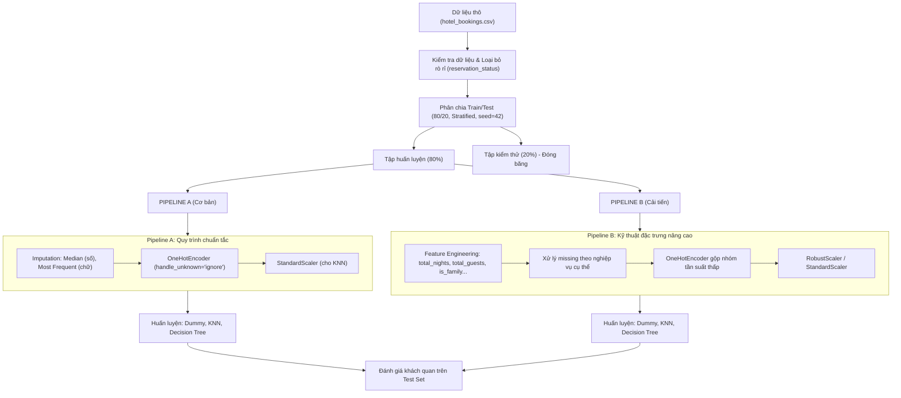

# PHƯƠNG PHÁP NGHIÊN CỨU VÀ QUY TRÌNH HỌC MÁY (METHODOLOGY)

## 1. ĐẶT BÀI TOÁN TOÁN HỌC

Bài toán dự đoán khách hàng hủy đặt phòng khách sạn được mô hình hóa dưới dạng bài toán **Học có giám sát – Phân loại nhị phân (Supervised Learning – Binary Classification)**:

Cho tập dữ liệu gồm $N$ mẫu quan sát:
$$\mathcal{D} = \{(\mathbf{x}_i, y_i)\}_{i=1}^N$$
Trong đó:
- $\mathbf{x}_i \in \mathbb{R}^d$ là vector đặc trưng mô tả thông tin của một lượt đặt phòng tại thời điểm phát sinh yêu cầu đặt phòng (bao gồm cả các biến số và biến phân loại sau khi mã hóa).
- $y_i \in \{0, 1\}$ là nhãn mục tiêu (`is_canceled`):
  - $y_i = 0$: Khách hàng thực hiện lưu trú thành công (không hủy phòng).
  - $y_i = 1$: Khách hàng hủy đặt phòng trước khi nhận phòng hoặc vắng mặt (No-Show).

Mục tiêu là học hàm ánh xạ $f_\theta: \mathcal{X} \rightarrow [0, 1]$ hoặc $g_\theta: \mathcal{X} \rightarrow \{0, 1\}$ sao cho cực tiểu hóa hàm mất mát kỳ vọng trên tập dữ liệu chưa từng quan sát (Unseen Test Data):
$$\min_\theta \mathbb{E}_{(\mathbf{x}, y) \sim \mathcal{P}} [\mathcal{L}(g_\theta(\mathbf{x}), y)]$$

---

## 2. NGUYÊN TẮC PHÒNG CHỐNG RÒ RỈ DỮ LIỆU (ANTI-LEAKAGE FRAMEWORK)

Rò rỉ dữ liệu (Data Leakage) xảy ra khi thông tin từ ngoài tập huấn luyện hoặc thông tin tương lai được vô tình đưa vào quá trình xây dựng mô hình, dẫn đến việc mô hình có kết quả quá lạc quan trong môi trường thử nghiệm nhưng thất bại khi triển khai thực tế.

Dự án áp dụng 3 cấp độ phòng chống rò rỉ:

1. **Cấp độ thời gian và nghiệp vụ (Temporal / Domain Leakage):**
   - Loại bỏ triệt để biến `reservation_status` (chứa các giá trị: *Check-Out, Canceled, No-Show*). Biến này được ghi nhận khi chu kỳ đặt phòng đã chấm dứt hoàn toàn. Nếu giữ lại, mô hình sẽ đạt độ chính xác 100% một cách phi thực tế.
   - Loại bỏ triệt để biến `reservation_status_date` (ngày cập nhật trạng thái cuối). Đây là thông tin sau khi giao dịch đã xử lý xong.
2. **Cấp độ phân chia tập dữ liệu (Split Leakage):**
   - Dữ liệu được phân chia $80\%$ Train và $20\%$ Test bằng phương pháp `StratifiedShuffleSplit` để giữ nguyên phân phối nhãn của biến mục tiêu `is_canceled`.
   - Giữ cố định `random_state = 42` để đảm bảo tính tái lập (Reproducibility).
   - Tập Test được "đóng băng" tuyệt đối, chỉ mở ra đúng một lần ở bước đánh giá cuối cùng.
3. **Cấp độ biến đổi và tiền xử lý (Transform Leakage):**
   - Tuyệt đối không áp dụng các bộ biến đổi như `StandardScaler`, `OneHotEncoder`, `SimpleImputer` trên toàn bộ tập dữ liệu trước khi chia.
   - Toàn bộ các bước này được đóng gói bên trong `sklearn.pipeline.Pipeline` và `sklearn.compose.ColumnTransformer`.
   - Các tham số thống kê ($\mu, \sigma$, median, danh mục phân loại) chỉ được tính toán bằng phương thức `.fit()` trên tập Train, sau đó áp dụng `.transform()` lên tập Validation và Test.

---

## 3. THIẾT KẾ HAI PHƯƠNG ÁN TIỀN XỬ LÝ (PIPELINE DESIGN)

---

## 4. CƠ SỞ LÝ THUYẾT CÁC MÔ HÌNH HỌC MÁY

### 4.1. Baseline Model – DummyClassifier
- **Bản chất:** Mô hình phân loại ngây thơ không học quy luật từ các đặc trưng $\mathbf{x}$, chỉ dựa trên phân phối của nhãn $y$.
- **Chiến lược:**
  - `most_frequent`: Luôn luôn dự đoán lớp chiếm đa số (Lớp 0: Không hủy).
  - `stratified`: Sinh dự đoán ngẫu nhiên theo đúng tỷ lệ lớp trong tập train.
- **Ý nghĩa:** Đóng vai trò là cột mốc tối thiểu. Bất kỳ mô hình học máy nào được coi là hữu ích đều phải vượt trội rõ rệt so với Baseline này.

### 4.2. K-Nearest Neighbors (KNN)
- **Bản chất:** Thuật toán phi tham số (non-parametric), dựa trên việc lưu trữ toàn bộ tập huấn luyện. Khi có mẫu mới $\mathbf{x}^*$, thuật toán tìm $k$ điểm dữ liệu gần nhất theo khoảng cách Minkowski:
  $$d(\mathbf{x}_i, \mathbf{x}_j) = \left( \sum_{m=1}^d |x_{im} - x_{jm}|^p \right)^{1/p}$$
  (với $p=2$ là khoảng cách Euclid, $p=1$ là khoảng cách Manhattan).
- **Quyết định phân loại:** Bầu chọn theo đa số (Majority Voting) hoặc có trọng số nghịch đảo khoảng cách:
  $$\hat{y} = \arg\max_{c \in \{0, 1\}} \sum_{i \in \mathcal{N}_k(\mathbf{x}^*)} \mathbb{I}(y_i = c)$$
- **Đặc thù cần lưu ý:** Rất nhạy cảm với thang đo của các đặc trưng, do đó bước chuẩn hóa dữ liệu (`StandardScaler`) là bắt buộc. Chi phí tính toán dự đoán tỷ lệ thuận với kích thước dữ liệu $O(N \cdot d)$.

### 4.3. Decision Tree (Cây quyết định)
- **Bản chất:** Thuật toán phân cấp chia đệ quy không gian đặc trưng thành các siêu hình hộp chữ nhật trực giao với các trục tọa độ.
- **Tiêu chuẩn phân chia:**
  - **Gini Impurity:**
    $$I_G(t) = 1 - \sum_{c=0}^1 p(c|t)^2$$
  - **Entropy:**
    $$H(t) = -\sum_{c=0}^1 p(c|t) \log_2 p(c|t)$$
  - **Information Gain:** Mức giảm độ hỗn loạn khi phân chia node $t$ thành các node con:
    $$\Delta = I(t) - \frac{N_L}{N_t} I(t_L) - \frac{N_R}{N_t} I(t_R)$$
- **Kiểm soát Overfitting (Pruning):** Giới hạn `max_depth`, đặt ngưỡng `min_samples_split`, `min_samples_leaf` để đảm bảo cây không ghi nhớ nhiễu trong dữ liệu huấn luyện.

---

## 5. HỆ CHỈ SỐ ĐÁNH GIÁ VÀ Ý NGHĨA TRONG NGHIỆP VỤ KHÁCH SẠN

Ma trận nhầm lẫn (Confusion Matrix):
| Thực tế \ Dự đoán | Dự đoán: Không hủy ($\hat{y}=0$) | Dự đoán: Có hủy ($\hat{y}=1$) |
|:---:|:---:|:---:|
| **Thực tế: Không hủy ($y=0$)** | True Negative (TN) | False Positive (FP) *(Báo động giả)* |
| **Thực tế: Có hủy ($y=1$)** | False Negative (FN) *(Bỏ sót nguy cơ)* | True Positive (TP) |

Các công thức toán học:
1. **Accuracy (Độ chính xác tổng quát):**
   $$\text{Accuracy} = \frac{TP + TN}{TP + TN + FP + FN}$$
2. **Precision (Độ chuẩn xác):**
   $$\text{Precision} = \frac{TP}{TP + FP}$$
   *Ý nghĩa nghiệp vụ:* Trong các đơn khách sạn dự đoán sẽ hủy, có bao nhiêu đơn thực sự hủy? Nếu Precision thấp, khách sạn đưa ra các chính sách can thiệp (ví dụ: hủy phòng tự động, gửi email nhắc nhở liên tục, hoặc overbooking quá sớm) sẽ làm phiền những khách hàng thực sự muốn ở lại.
3. **Recall (Độ thu hồi / Nhạy):**
   $$\text{Recall} = \frac{TP}{TP + FN}$$
   *Ý nghĩa nghiệp vụ:* Trong tổng số khách hàng thực sự hủy phòng, mô hình phát hiện được bao nhiêu phần trăm? Trong bối cảnh khách sạn, Recall là chỉ số cực kỳ quan trọng vì nếu để sót một đơn hủy (False Negative), phòng sẽ bị để trống bất ngờ và khách sạn chịu tổn thất 100% doanh thu đêm đó.
4. **F1-Score (Trung bình điều hòa):**
   $$F_1 = 2 \cdot \frac{\text{Precision} \cdot \text{Recall}}{\text{Precision} + \text{Recall}}$$
5. **ROC-AUC (Area Under the Receiver Operating Characteristic Curve):**
   Đánh giá năng lực phân loại của mô hình trên mọi ngưỡng xác suất (threshold-independent).
